<a href="https://bymankirat.github.io/myportfolio/"></a>



Click a cartridge to run its live report. Every project runs end to end on real public data with one command.

<a href="https://bymankirat.github.io/swapseq/"></a>

<a href="https://bymankirat.github.io/swapseq/"><b>▶ Run SwapSeq</b></a> · <a href="https://bymankirat.github.io/swapseq/atlas/"><b>SwapSeq Atlas</b></a> · <a href="https://github.com/bymankirat/swapseqr"><b>R package (swapseqr)</b></a> · <a href="https://bymankirat.github.io/swapseq/validation.html">Methods &amp; validation</a> · <a href="https://doi.org/10.5281/zenodo.23963612">DOI</a>

<table>
<tr>
<td width="50%"><a href="https://bymankirat.github.io/clinical-trial-risk/"></a></td>
<td width="50%"><a href="https://bymankirat.github.io/cdisc-pilot-analysis/"></a></td>
</tr>
<tr>
<td width="50%"><a href="https://bymankirat.github.io/GPC3-Pan-Cancer-Biomarker/"></a></td>
<td width="50%"><a href="https://bymankirat.github.io/H7N9-Transcriptomics-Pipeline/"></a></td>
</tr>
<tr>
<td width="50%"><a href="https://bymankirat.github.io/SOG1-Banana-Comparative-Genomics/"></a></td>
<td width="50%"><a href="https://bymankirat.github.io/ireland-electricity-demand/"></a></td>
</tr>
<tr>
<td width="50%"><a href="https://bymankirat.github.io/ireland-wind-dispatch-down/"></a></td>
<td width="50%"><a href="https://bymankirat.github.io/cork-2040-grid/"></a></td>
</tr>
<tr>
<td width="50%"><a href="https://bymankirat.github.io/cork-commuter-rail-2040/"></a></td>
<td width="50%"><a href="https://bymankirat.github.io/ireland-census-health/"></a></td>
</tr>
<tr>
<td width="50%"><a href="https://bymankirat.github.io/irish-water-low-flow-warning/"></a></td>
<td width="50%"><a href="https://bymankirat.github.io/Store-KPI-Controlling-Toolkit/"></a></td>
</tr>
<tr>
<td width="50%"><a href="https://bymankirat.github.io/ireland-unemployment-outlook/"></a></td>
<td width="50%"><a href="https://bymankirat.github.io/CYP19A1-Expression-Ovarian-R/"></a></td>
</tr>
</table>

<b>📼 Full cartridge library: report and code for every project</b>

 

| Project | Links |
|---|---|
| SwapSeq: sample mix-up checker for microbiome studies (JavaScript, v1.1.1) | [Tool](https://bymankirat.github.io/swapseq/) · [Methods](https://bymankirat.github.io/swapseq/validation.html) · [Code](https://github.com/bymankirat/swapseq) · [DOI](https://doi.org/10.5281/zenodo.23963612) |
| SwapSeq Atlas: how checkable are 42 public microbiome datasets? | [Atlas](https://bymankirat.github.io/swapseq/atlas/) · [Code and data](https://github.com/bymankirat/swapseq/tree/main/atlas) |
| swapseqr: SwapSeq in R (phyloseq or count matrix) | [Code](https://github.com/bymankirat/swapseqr) |
| Why clinical trials stop early | [Report](https://bymankirat.github.io/clinical-trial-risk/) · [Code](https://github.com/bymankirat/clinical-trial-risk) |
| Clinical trial safety, SDTM to ADaM (R, CDISC, admiral) | [Report](https://bymankirat.github.io/cdisc-pilot-analysis/) · [Code](https://github.com/bymankirat/cdisc-pilot-analysis) |
| Glypican-3 across 33 cancers (Python, TCGA + GTEx, Cox, GSEA, AlphaFold) | [Phase 2](https://bymankirat.github.io/GPC3-Pan-Cancer-Biomarker/) · [Phase 1](https://bymankirat.github.io/GPC3-Pan-Cancer-Biomarker/phase1.html) · [Code](https://github.com/bymankirat/GPC3-Pan-Cancer-Biomarker) |
| What makes H7N9 different? (R, limma, fgsea, WGCNA) | [Report](https://bymankirat.github.io/H7N9-Transcriptomics-Pipeline/) · [Code](https://github.com/bymankirat/H7N9-Transcriptomics-Pipeline) |
| SOG1 in banana, phase 2 (Python, HMMER, IQ-TREE, dN/dS) | [Report](https://bymankirat.github.io/SOG1-Banana-Comparative-Genomics/) · [Code](https://github.com/bymankirat/SOG1-Banana-Comparative-Genomics) |
| CYP19A1 across human, mouse and ovarian cancer (R, GTEx, TCGA) | [Report](https://bymankirat.github.io/CYP19A1-Expression-Ovarian-R/) · [Code](https://github.com/bymankirat/CYP19A1-Expression-Ovarian-R) |
| Irish electricity demand | [Report](https://bymankirat.github.io/ireland-electricity-demand/) · [Code](https://github.com/bymankirat/ireland-electricity-demand) |
| Wind turned away by the all-island grid | [Report](https://bymankirat.github.io/ireland-wind-dispatch-down/) · [Code](https://github.com/bymankirat/ireland-wind-dispatch-down) |
| Cork & Dublin 2040 grid plans | [Cork](https://bymankirat.github.io/cork-2040-grid/) · [Dublin](https://bymankirat.github.io/cork-2040-grid/dublin/) · [Code](https://github.com/bymankirat/cork-2040-grid) |
| Cork commuter rail 2040 | [Report](https://bymankirat.github.io/cork-commuter-rail-2040/) · [Map](https://bymankirat.github.io/cork-commuter-rail-2040/map.html) · [Code](https://github.com/bymankirat/cork-commuter-rail-2040) |
| Health and deprivation across Ireland | [Report](https://bymankirat.github.io/ireland-census-health/) · [Code](https://github.com/bymankirat/ireland-census-health) |
| River low-flow warning | [Report](https://bymankirat.github.io/irish-water-low-flow-warning/) · [Code](https://github.com/bymankirat/irish-water-low-flow-warning) |
| Irish unemployment outlook | [Report](https://bymankirat.github.io/ireland-unemployment-outlook/) · [Code](https://github.com/bymankirat/ireland-unemployment-outlook) |
| Store KPI controlling toolkit (simulated data) | [Report](https://bymankirat.github.io/Store-KPI-Controlling-Toolkit/) · [Code](https://github.com/bymankirat/Store-KPI-Controlling-Toolkit) |
| Subscriber propensity and opportunity map (simulated subscribers) | [Code](https://github.com/bymankirat/Subscriber-Propensity-Opportunity-Map) |
| Microtomy and H&E image analysis | [Report](https://bymankirat.github.io/HE-Histology-Image-Analysis/) · [Code](https://github.com/bymankirat/HE-Histology-Image-Analysis) |
| Wine classification with SVM (group project, UCC) | [Report](https://bymankirat.github.io/DATA-ENG-SVM-REGRESSION-/) · [Code](https://github.com/bymankirat/DATA-ENG-SVM-REGRESSION-) |


<b>🧬 Save file: research experience</b>

 

- **MSc thesis · IBIMA Plataforma BIONAND, Málaga (2026):** gut microbiota and faecal metabolomics before and after bariatric surgery, with healthy lean controls as a reference; 16S rRNA in QIIME2, multi-omics integration in R (mixOmics)
- **R&D · Premas Life Sciences, New Delhi (2024-25):** NGS diagnostic kits for *Mycobacterium tuberculosis* and 3 other infections; Illumina workflow 20% more efficient
- **Research · BRIC-NABI, Mohali (2023, 2024):** *Cyp19a1* expression across human and mouse models; *Ma-SOG1* expression vectors in banana, followed up in [phase 2](https://bymankirat.github.io/SOG1-Banana-Comparative-Genomics/) across 17 plant genomes
- **Summer research · DS Kothari Centre, Miranda House (2023):** microtomy and H&E staining, research poster

<b>🕹️ Rules of the game: how I work</b>

 

1. **Real data, checked first.** Every download is fingerprinted, and automatic checks stop the run if something is off.
2. **Test on what the model hasn't seen.** Later years, held-out counties, and always a simple baseline to beat.
3. **Check my own work.** Independent second versions of key results, unit tests, and comparisons with published references.
4. **Show the uncertainty.** Ranges and confidence intervals, not single magic numbers.
5. **Write down the limits.** Every report ends with what it can't tell you.

