<a href="https://bymankirat.github.io/myportfolio/"></a>

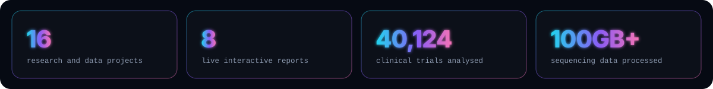

Click a card to open the live report. Every project runs end to end on real data with one command.

<table>
<tr>
<td width="50%"><a href="https://bymankirat.github.io/clinical-trial-risk/"></a></td>
<td width="50%"><a href="https://bymankirat.github.io/cdisc-pilot-analysis/"></a></td>
</tr>
<tr>
<td width="50%"><a href="https://bymankirat.github.io/barley-weather-beer/"></a></td>
<td width="50%"><a href="https://bymankirat.github.io/cork-2040-grid/"></a></td>
</tr>
<tr>
<td width="50%"><a href="https://bymankirat.github.io/ireland-electricity-demand/"></a></td>
<td width="50%"><a href="https://bymankirat.github.io/ireland-census-health/"></a></td>
</tr>
<tr>
<td width="50%"><a href="https://bymankirat.github.io/irish-water-low-flow-warning/"></a></td>
<td width="50%"><a href="https://bymankirat.github.io/ireland-unemployment-outlook/"></a></td>
</tr>
</table>

<b>📂 Code for every project</b>

 

| Project | Links |
|---|---|
| Why clinical trials stop early | [Report](https://bymankirat.github.io/clinical-trial-risk/) · [Code](https://github.com/bymankirat/clinical-trial-risk) |
| Clinical trial safety, SDTM to ADaM (R, CDISC, admiral) | [Report](https://bymankirat.github.io/cdisc-pilot-analysis/) · [Code](https://github.com/bymankirat/cdisc-pilot-analysis) |
| Barley, Weather and Beer | [Report](https://bymankirat.github.io/barley-weather-beer/) · [Code](https://github.com/bymankirat/barley-weather-beer) |
| Cork & Dublin 2040 grid plans | [Cork](https://bymankirat.github.io/cork-2040-grid/) · [Dublin](https://bymankirat.github.io/cork-2040-grid/dublin/) · [Code](https://github.com/bymankirat/cork-2040-grid) |
| Irish electricity demand | [Report](https://bymankirat.github.io/ireland-electricity-demand/) · [Code](https://github.com/bymankirat/ireland-electricity-demand) |
| Health and deprivation | [Report](https://bymankirat.github.io/ireland-census-health/) · [Code](https://github.com/bymankirat/ireland-census-health) |
| River low-flow warning | [Report](https://bymankirat.github.io/irish-water-low-flow-warning/) · [Code](https://github.com/bymankirat/irish-water-low-flow-warning) |
| Irish unemployment outlook | [Report](https://bymankirat.github.io/ireland-unemployment-outlook/) · [Code](https://github.com/bymankirat/ireland-unemployment-outlook) |

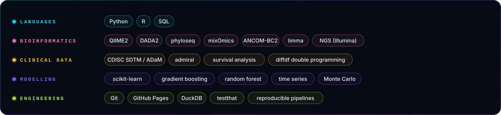

<b>🧬 Research experience</b>

 

- **MSc thesis · IBIMA Plataforma BIONAND, Málaga (2026):** gut microbiota and faecal metabolomics after bariatric surgery; 100GB+ of 16S rRNA sequencing data in QIIME2 and multi-omics integration in R (mixOmics), 15+ candidate biomarkers
- **R&D · Premas Life Sciences, New Delhi (2024-25):** NGS diagnostic kits for *Mycobacterium tuberculosis* and 3 other infections; Illumina workflow 20% more efficient
- **Research · NABI, Mohali (2023, 2024):** *Cyp19a1* expression across human and mouse models; *Ma-SOG1* expression vectors in banana
- **Summer research · DS Kothari Centre, Miranda House (2023):** microtomy and H&E staining, research poster

<b>🧭 How I work</b>

 

1. **Real data, checked first.** Every download is fingerprinted, and automatic checks stop the run if something is off.
2. **Test on what the model hasn't seen.** Later years, held-out counties, and always a simple baseline to beat.
3. **Check my own work.** Independent second versions of key results, unit tests, and comparisons with published references.
4. **Show the uncertainty.** Ranges and confidence intervals, not single magic numbers.
5. **Write down the limits.** Every report ends with what it can't tell you.

Mankirat Singh · Cork, Ireland · <a href="https://bymankirat.github.io/myportfolio/">bymankirat.github.io/myportfolio</a>

